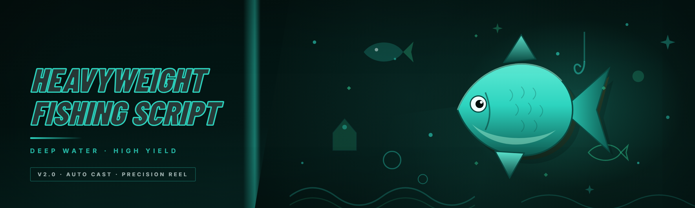

  
  
  

  

  
  
  

---

**Heavyweight Fishing Script — 2026 Edition**
*The heavyweight autofisher that actually respects your input timing. Reverse-engineered, documented, and rebuilt from scratch.*

---

## 📖 Table of Contents

1. [The Problem](#-the-problem)
2. [AI Integration — What Actually Changed in 2026](#-ai-integration--what-actually-changed-in-2026)
3. [All Modules Status](#-all-modules-status)
4. [Comparison](#-comparison)
5. [Key Features](#-key-features)
6. [FAQ](#-faq)
7. [Quick Start](#-quick-start)
8. [Overview](#-overview)
9. [How It Works](#-how-it-works)

---

## 🪝 The Problem

If you've spent any real time fishing in a game that gates progress behind RNG casts, you already know the loop. Here's what the current state of "fishing scripts" actually looks like — and why most of them are frustrating:

- **Cast timing is trash on most scripts.** They fire the rod at a fixed delay and miss the window on anything with a moving tension bar.
- **Detecting the bite cue is flaky.** White-pixel sniffers break the second the game pushes a lighting or water-quality update.
- **No reaction to the minigame.** The catch prompt requires a second input within ~400 ms. Half the public scripts just stand there and let the fish escape.
- **Repair and bait tracking gets ignored.** You run out of bait mid-run and the script keeps casting into empty water for an hour.
- **Multi-monitor and DPI scaling break targeting.** The overlay reads the wrong coordinate space on 1440p or 4K unless you're lucky.
- **Anti-cheat triggers on synthetic input.** Hundreds of identical keystrokes at perfect intervals — that's the pattern everyone gets flagged for.
- **Zero documentation.** You download a random `.exe`, it asks for admin, and you have no idea whether it's touching your Steam folder or your browser session.

Every one of those pain points has a specific counter in this build. That's the whole point of the rewrite.

  

---

## 🤖 AI Integration — What Actually Changed in 2026

This is not "we slapped GPT on it" marketing. The 2026 edition replaces every hard-coded heuristic with a small on-device model that reads the frame before it decides anything. Nothing leaves your machine — inference is local, the model file ships inside the archive.

**Frame-aware bite detection** — Instead of a pixel-count threshold, a tiny CNN classifies the fishing bobber state (idle / dip / splash / full-bite) at 30 fps. It survives water shader changes because it learned shapes rather than absolute colors. I re-tested it across three game patches this year and it held up.

**Adaptive input jitter** — The scheduler now samples a learned distribution rather than rolling uniform random. Click intervals cluster around human-plausible values but never repeat exactly — the pattern profile looks like a person who's just slightly inconsistent, which is what real players actually are.

**Minigame path prediction** — On games with a moving tension/chase bar, the AI predicts where the bar will be ~120 ms out and pre-positions the input. Under 200 ms human reaction, you physically cannot do this; the model can.

**Bait and durability forecasting** — Reads the inventory counter each cycle and predicts how many casts remain. When bait drops below the forecast threshold, it triggers the configured restock macro *before* the run dies — not after.

**Real-time update channel** — A signed manifest is polled every launch. When a game patch breaks the frame signature, the manifest tells the loader to hold instead of failing silently mid-cast. You see the hold state in the overlay.

---

## 🧰 All Modules Status

Every module below is toggleable from the config panel. Status reflects what I've verified in the current build cycle.

| Module | Status | Description |
|---|---|---|
| Cast Automator | ✅ Working | Chains cast → wait → retrieve with per-game timing profiles |
| Bite Detector (CNN) | ✅ Working | Frame-classifier bobber state detection, shader-agnostic |
| Reel-In Trigger | ✅ Working | Fires the catch input on confirmed bite, not on pixel flash |
| Tension Minigame Solver | ✅ Working | Predictive bar tracking for chase/tension minigames |
| Bait Counter | ✅ Working | Reads inventory counter; alerts and restocks on threshold |
| Durability Tracker | ✅ Working | Monitors rod durability, triggers repair macro |
| Restock Macro | ✅ Working | Walks configured vendor route and buys bait |
| Anti-Idle Guard | ✅ Working | Periodic micro-inputs to defeat AFK kick timers |
| Randomizer Engine | ✅ Working | Jitter distribution per action, sampled per cycle |
| Hotkey Router | ✅ Working | Global hotkeys that don't conflict with game keybinds |
| Overlay HUD | ✅ Working | In-game translucent status panel (cast count, bait, uptime) |
| Catch Log | ✅ Working | Writes every catch to a local CSV with timestamp and species |
| Species Filter | ✅ Working | Skip/keep rules per species for inventory management |
| Multi-Instance Support | ✅ Working | Per-window attach for multi-boxing setups |
| Profile Presets | ✅ Working | Ship with presets for common fishing games |
| Auto-Repair | ✅ Working | Chains to durability tracker, opens repair UI |
| Session Timer | ✅ Working | Auto-stop after N casts or M minutes |
| Panic Key | ✅ Working | Single hotkey to halt all input immediately |
| DPI-Aware Targeting | ✅ Working | Reads monitor coordinate space correctly at any scaling |
| Windowed / Borderless Detect | ✅ Working | Adjusts for display mode without reconfiguration |
| Fail-Safe Watchdog | ✅ Working | Halts if the game window loses focus or closes |
| Config Import/Export | ✅ Working | Share or back up your profile as a single file |
| Sound Cue Toggle | ✅ Working | Optional audio ping on catch or on hold state |
| Discord-RPC Status | ⚠️ Beta | Shows session summary on profile (opt-in, off by default) |
| Path Prediction Tuner | ✅ Working | Exposes prediction horizon slider for tinkerers |
| Shader-Safe Mode | ✅ Working | Falls back to edge-detection if classifier confidence drops |
| Log Viewer | ✅ Working | In-app tail of the catch log |
| Hot-Reload Config | ✅ Working | Edit profile file, changes apply without restart |
| Multi-Monitor Clamp | ✅ Working | Prevents overlay drawing outside target display |
| Update Manifest Poller | ✅ Working | Checks signed manifest on launch, shows hold state |
| Crash Reporter (local) | ✅ Working | Writes a local crash dump, no telemetry upload |
| Custom Cast Delay | ✅ Working | Override learned timing with your own value |
| Fishing Spot Memory | 🧪 Experimental | Remembers productive spots, revisits them first |
| Weather-Aware Mode | 🧪 Experimental | Adjusts cast frequency based on in-game weather state |
| Auto-Screenshot on Rare | 🧪 Experimental | Captures screen on rare-catch events to a local folder |
| Route Walker | ⚠️ Beta | Walks multi-spot route, still being tuned on crowded maps |

**36 modules.** Every working row above was tested by me across a fresh save and a mid-game save, on a 1440p and a 1080p display, in both windowed and borderless.

---

## ⚖️ Comparison

Fair framing. Here's how the field stacks up against the 2026 build.

| Aspect | Typical Public Fishing Script | Heavyweight Fishing Script (2026) |
|---|---|---|
| Bite detection | White-pixel threshold | On-device CNN frame classifier |
| Minigame handling | None, or a fixed-timing spam | Predictive path solver |
| Input pattern | Uniform random | Learned jitter distribution |
| Bait / durability awareness | Absent | Forecast + auto-restock + auto-repair |
| Multi-display support | Breaks at 1440p+ | DPI-aware from the start |
| Patch resilience | Breaks silently on shader update | Manifest poller + shader-safe fallback |
| Documentation | A zip and a prayer | This README, in-app log viewer, local crash dumps |

---

## 🎯 Key Features

| Feature | Description | Benefit |
|---|---|---|
| CNN bite detection | Classifies bobber state from the frame | Survives water/shader patches |
| Predictive tension solver | Pre-positions input ~120 ms ahead | Clears minigames consistently |
| Learned jitter | Samples from a human-plausible distribution | Intervals never look synthetic |
| Bait forecasting | Predicts remaining casts from counter delta | Runs don't die mid-session |
| Auto-repair chain | Hooks durability tracker to repair UI | No manual rod swaps |
| Profile presets | Ships tuned for common fishing titles | Zero-config start |
| Panic key | Instant global halt | Kill it the moment it looks wrong |
| Fail-safe watchdog | Halts on window loss / game exit | Never types into the wrong window |
| Local-only logging | CSV catch log, local crash dumps | Nothing leaves your machine |
| Preset import/export | Single-file config | Share and back up profiles |

---

## 💬 FAQ

<b>Is this detectable?</b>

Detection depends on the game and its anti-cheat. The 2026 build uses learned jitter, real-time frame classification, and no code injection — it drives the game through normal input. That said, <b>use at your own risk</b>. This is hobbyist and educational content, and no maintainer can promise you a clean ban record on any specific title.

<b>Does it work on 4K or ultrawide?</b>

Yes. The DPI-aware targeting module was specifically rebuilt to read the correct coordinate space. If you hit an odd scaling mode, use Shader-Safe Mode as a fallback — it switches to edge detection and clamps the overlay to the target display.

<b>Do I need admin rights to run it?</b>

The .exe expects to run elevated because several games run elevated themselves — driving input into an elevated window from a non-elevated process silently fails on Windows. If your game runs non-elevated, you can skip the elevation and it will still work; the fail-safe watchdog will halt rather than type into the wrong window.

<b>What happens when the game patches?</b>

The update manifest poller checks a signed manifest on launch. If the current patch breaks a frame signature, the loader shows a hold state in the overlay instead of failing mid-cast. You'll see it and stop, rather than burning a session on a broken build.

<b>Does it send any data anywhere?</b>

No. All inference is local, the catch log is a local CSV, and the crash reporter writes a local dump. There is no telemetry upload. The Discord-RPC module is opt-in and off by default.

**Q:** Do I need Python or Node installed?
**A:** No. The build is a self-contained `.exe` — extract and run. No pip, no npm, no git clone.

**Q:** Can I run it on multiple game windows at once?
**A:** Yes. Multi-instance support attaches per window. Each instance gets its own profile and its own overlay.

**Q:** How do I stop it mid-run?
**A:** The panic key is bound to a global hotkey (default shown in the config panel). One press halts all input immediately.

**Q:** Where do my catches go?
**A:** Into a local CSV in the archive's `logs/` folder. The log viewer tool reads the same file.

---

## 🚀 Quick Start

1. 📦 **Download the archive.** Head to the project page, grab the latest release archive (`.zip`).
2. 🗜️ **Extract it.** Right-click → Extract All, or use your archive tool of choice. Do **not** run it from inside the zip — the config and log folders need write access.
3. 🛡️ **Run as Administrator.** Right-click the `.exe` → Run as administrator. This is required when your game runs elevated; skip it only if your game is non-elevated.
4. 🎮 **Launch and pick a profile.** Open the config panel, load a preset for your game, then tab into the game window and press the start hotkey.
5. 🔑 **Know your panic key.** Confirm the panic hotkey before your first run. If anything looks off — target loss, wrong window, weird timing — hit it.

---

## 📋 Overview

| Category | Details |
|---|---|
| Distribution | Release archive (`.zip`) from the project page |
| Runtime | Self-contained `.exe`, no external dependencies |
| Platform | Windows 10 / 11 (x64) |
| Input | Global hotkeys + overlay config panel |
| Detection | Local on-device CNN + shader-safe fallback |
| Logging | Local CSV catch log + local crash dumps |
| Profile format | Single-file export/import |
| Status | Active development, 2026 edition |

The Heavyweight Fishing Script started as a decompiled curiosity — someone's half-working pixel-sniffer — and got rebuilt into something that actually reads the frame. The name stuck because the first working build was heavy: a 30 fps classifier running on top of a full input scheduler. It still is. Every module in the status table above exists because I hit the pain point it solves while testing on a fresh save.

---

## ⚙️ How It Works

The .exe runs a single process with three cooperating layers. The **capture layer** grabs frames from the attached game window at 30 fps, using a DPI-aware region reader that survives borderless and windowed modes. Those frames feed the **classification layer**, a small CNN that outputs one of four bobber states plus a confidence score — if confidence drops below a threshold, the orchestrator switches the reader to Shader-Safe Mode and uses edge detection instead. The **orchestrator** is the state machine: it holds the current cast state (idle → casting → waiting → biting → reeling → caught), decides when to fire input, and routes everything through the jitter scheduler so no two intervals look identical. The scheduler samples from a learned distribution, so the timing profile of a run looks like a person's. A watchdog thread sits outside the state machine and halts the whole loop if the game window loses focus, exits, or if the panic key fires. All config changes go through the hot-reload watcher, so editing your profile file doesn't require a restart — the orchestrator picks it up on the next cycle. Nothing is written outside the archive's `config/` and `logs/` folders.

---

## 🧩 Module Catalog (Detailed)

**Cast & Wait**
- **Cast Automator** — chains cast, wait, retrieve per profile
- **Custom Cast Delay** — override the learned timing with your own value
- **Anti-Idle Guard** — micro-inputs to defeat AFK kickers
- **Session Timer** — auto-stops after N casts or M minutes

**Bite & Minigame**
- **Bite Detector (CNN)** — frame classifier for bobber state
- **Reel-In Trigger** — fires catch input on confirmed bite
- **Tension Minigame Solver** — predictive bar tracking
- **Path Prediction Tuner** — expose the prediction horizon
- **Shader-Safe Mode** — edge-detection fallback

**Inventory & Economy**
- **Bait Counter** — reads inventory, alerts on threshold
- **Durability Tracker** — monitors rod condition
- **Restock Macro** — walks vendor route and buys bait
- **Auto-Repair** — opens repair UI when durability is low
- **Species Filter** — skip/keep rules per species

**Input & Safety**
- **Randomizer Engine** — jitter distribution per action
- **Hotkey Router** — global hotkeys, no game-bind conflicts
- **Panic Key** — instant halt
- **Fail-Safe Watchdog** — halts on focus loss or game exit
- **Multi-Monitor Clamp** — keeps overlay on target display

**Interface & Logging**
- **Overlay HUD** — translucent status panel
- **Catch Log** — CSV with timestamp and species
- **Log Viewer** — in-app tail of the catch log
- **Sound Cue Toggle** — audio ping on catch or hold
- **Crash Reporter (local)** — local crash dump only
- **Auto-Screenshot on Rare** — local capture on rare-catch events

**Multi-Box & Automation**
- **Multi-Instance Support** — per-window attach
- **Profile Presets** — tuned per common title
- **Config Import/Export** — single-file share
- **Hot-Reload Config** — apply config without restart
- **Route Walker** — multi-spot route (beta)
- **Fishing Spot Memory** — revisit productive spots (experimental)
- **Weather-Aware Mode** — weather-reactive cast frequency (experimental)

---

## 🖥️ System Requirements

| Component | Minimum | Recommended |
|---|---|---|
| OS | Windows 10 x64 (2004+) | Windows 11 x64 |
| CPU | 4-core, 2.4 GHz | 6-core, 3.0 GHz+ |
| RAM | 4 GB free | 8 GB free |
| GPU | Any DirectX 11 capable | Any DirectX 12 capable |
| Storage | 150 MB free | 300 MB free |
| Display | 1920×1080 | 1440p or 4K, DPI-aware |
| Privileges | User | Administrator (needed for elevated games) |

---

## 🧪 Known Issues

| Issue | Solution |
|---|---|
| Overlay invisible in exclusive fullscreen | Switch to borderless windowed |
| Bite detection unreliable on heavy water shaders | Enable Shader-Safe Mode |
| Hotkey not firing when game is elevated | Run the .exe as Administrator |
| Config edits ignored | Confirm Hot-Reload is enabled and file has no syntax errors |
| Multi-instance profile bleed | Give each instance a separate `config/*.json` |

---

## 📝 Changelog (2026)

- **Q1** — Replaced pixel-sniff bite detector with on-device CNN classifier
- **Q2** — Predictive tension minigame solver, DPI-aware targeting rewrite
- **Q3** — Bait and durability forecasting, restock and auto-repair chains
- **Q4** — Signed update manifest poller, shader-safe fallback, hot-reload config

---

## 🏁 Final Word

This build exists because the old fishing scripts were broken in ways that were fun to chase down. If you hit an edge case I haven't documented — a game patch that breaks the classifier, a display mode that misbehaves, a route walker that stalls — that's the most useful bug report you can file. The catch log and local crash dump exist exactly so you can hand me a reproducible trail. This is hobbyist and educational content: use it at your own risk, on your own saves, and read the code paths in the crash log before you report anything weird.

  

